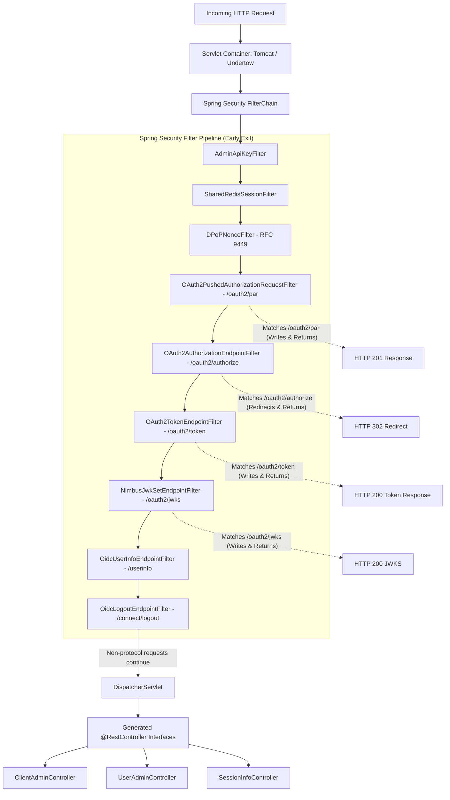

# Architectural Decision Record (ADR)
## Selective OpenAPI Code Generation for OAuth 2.1 Authorization Server

- **Status**: Accepted / Recommended
- **Context**: Spring Boot 4.x / Spring Security 7.x / Spring Authorization Server
- **Audience**: Principal Architects, Lead Software Engineers, Security & Compliance Reviewers

---

## 1. Executive Summary

This document provides the technical, architectural, and security justification for adopting a **Selective Code Generation Pattern** with the `openapi-generator-maven-plugin` on the OAuth 2.1 Authorization Server.

While the published OpenAPI 3.0.3 specification (`auth-server-api.yaml`) defines **100% of all routes** (including OAuth 2.1 protocol, OpenID Connect, and administration endpoints), code generation on the server is intentionally configured with:

```xml
<apisToGenerate>ClientAdmin,UserAdmin,SessionInfo</apisToGenerate>
```

This configuration generates Spring MVC controller interfaces strictly for custom management routes (`/api/admin/**`, `/me`), while delegating protocol routes (`/oauth2/token`, `/oauth2/authorize`, `/oauth2/par`, `/oauth2/jwks`, `/userinfo`, `/connect/logout`) directly to **Spring Authorization Server's native `SecurityFilterChain`**.

```
                ┌──────────────────────────────────────────────┐
                │          auth-server-api.yaml                │
                │        (Complete 100% Route Spec)            │
                └──────────────────────┬───────────────────────┘
                                       │
            ┌──────────────────────────┴──────────────────────────┐
            ▼                                                     ▼
┌───────────────────────────────┐             ┌───────────────────────────────────────┐
│     Client SDK Consumers      │             │         spring-auth-server            │
│  (Next.js, Gateways, Portals) │             │                                       │
│  - 100% generated client SDK  │             │  ┌─────────────────────────────────┐  │
│  - Fully typed contracts      │             │  │ Protocol Routes (OAuth2/OIDC)   │  │
│  - Zero manual fetch typing   │             │  │ ▶ Handled by Security Filter    │  │
└───────────────────────────────┘             │  └─────────────────────────────────┘  │
                                              │  ┌─────────────────────────────────┐  │
                                              │  │ Application Admin Routes        │  │
                                              │  │ ▶ Generated Spring MVC Api      │  │
                                              │  └─────────────────────────────────┘  │
                                              └───────────────────────────────────────┘
```

---

## 2. Technical Driver: FilterChain vs. DispatcherServlet Pipeline

In standard Spring Boot web applications, HTTP requests do not hit Spring MVC controllers immediately. All incoming traffic traverses the **Servlet FilterChain** *before* reaching the `DispatcherServlet`:



### The Architectural Conflict

1. **Protocol filters terminate the request**: When a request matches a protocol endpoint (such as `POST /oauth2/token`), the dedicated filter (`OAuth2TokenEndpointFilter`) authenticates the client, validates token grants, writes JSON directly to the `HttpServletResponse` output stream, and executes `return;`. **It does not call `filterChain.doFilter()`**.
2. **Controllers are unreachable**: Because the filter chain terminates early, any generated `@RestController` implementing `OAuth2ProtocolApi` will **never receive the request**. The controller method sits as dead, unreachable code.
3. **Bypassing filters causes architectural breakdown**: If developers attempt to disable the filter endpoints to force traffic through a generated `@RestController`, all built-in Spring Authorization Server security components are bypassed.

---

## 3. Security Risk Assessment: Why Custom Controllers Break Zero-Trust

If an organization attempts to bypass Spring Authorization Server's filters to force OAuth 2.1 endpoints into custom controller implementations, the following RFC-mandated security mechanisms must be re-implemented manually:

| Standard | Security Mechanism | Provided Out-of-the-Box by Filter Pipeline | Risk If Handled in Custom Controller |
| :--- | :--- | :--- | :--- |
| **RFC 9449** | **DPoP (Demonstrating Proof of Possession)** | `DPoPNonceFilter` and `StrictDPoPTokenRequestAuthenticationConverter` validate EC key proofs, manage server nonces in Redis, and bind `cnf.jkt` to tokens. | High vulnerability to replay attacks, private key thumbprint mismatch, and timing vulnerabilities in nonce verification. |
| **RFC 7523** | **`private_key_jwt` Client Authentication** | `ClientAssertionDecoderFactory` and `NimbusJwtDecoder` verify asymmetric signatures against PostgreSQL public keys, check `jti` replays in Redis, and enforce 5-minute skew windows. | Hand-rolled JWT extraction risks bypassing signature checks, replay detection, or audience/issuer validation. |
| **RFC 9126** | **Pushed Authorization Requests (PAR)** | `OAuth2PushedAuthorizationRequestEndpointFilter` cryptographically binds parameters to short-lived `request_uri` references. | Custom storage risks parameter tampering, leaking authorization parameters into access logs, or violating the 90-second expiration rule. |
| **RFC 7636** | **PKCE (Proof Key for Code Exchange)** | Built-in SHA-256 verifier computation and authorization code binding. | Risk of downgrade attacks or code intercept attacks if S256 verification is improperly implemented. |
| **RFC 9221** | **JARM (JWT Secured Authorization Response Mode)** | Built-in response signing using AWS KMS asymmetric EC keys. | Exposure of signing keys or improper header formatting (`alg: ES256`, `iss`, `aud`). |

> Re-implementing OAuth 2.1 protocol filters in custom `@RestController` code constitutes **reinventing cryptographic and protocol state engines by hand**, creating significant attack surface and violating zero-trust principles.

---

## 4. Industry Standards: Wire Contract vs. Implementation Decoupling

Enterprise architecture standards (e.g. OpenID Foundation, Apigee, Kong, AWS API Gateway) emphasize **contract-first on the wire**, not universal controller generation on the server:

```
        ┌────────────────────────────────────────────────────────┐
        │                 auth-server-api.yaml                   │
        │             Published OpenAPI Specification            │
        └───────────────────────────┬────────────────────────────┘
                                    │
           ┌────────────────────────┴────────────────────────┐
           ▼                                                 ▼
┌───────────────────────────────┐         ┌─────────────────────────────────────┐
│       The Wire Contract       │         │        Server Implementation        │
│                               │         │                                     │
│  - Every route documented     │         │  - High-level custom endpoints:     │
│  - Exact status codes (200,   │         │    Generated Spring MVC Controllers │
│    201, 400, 401, 403, 500)   │         │                                     │
│  - RFC 9449 DPoP headers      │         │  - Low-level protocol endpoints:    │
│  - JSON schema validation     │         │    Certified Security FilterChain   │
└───────────────────────────────┘         └─────────────────────────────────────┘
```

- **For external clients (Next.js, mobile apps, partner gateways)**:
  Consumers run `openapi-generator-cli` or `@hey-api/openapi-ts` against `auth-server-api.yaml`. They receive a 100% typed, generated SDK for all endpoints (`issueToken()`, `pushedAuthorizationRequest()`, `listClients()`, etc.).
- **For the Authorization Server**:
  The application satisfies the OpenAPI contract **byte-for-byte on the wire**, but leverages Spring Security's native implementation where appropriate.

---

## 5. Architectural Comparison Matrix

| Consideration | Option 1: Blanket Controller Generation | Option 2: Controller Delegation to AuthenticationManager | Option 3: Selective Code Generation (Adopted) |
| :--- | :--- | :--- | :--- |
| **OpenAPI Spec Completeness** | 100% | 100% | **100%** |
| **Client SDK Generation** | 100% | 100% | **100%** |
| **Spring Security Compliance** | ❌ Broken (Controllers unreachable or filters bypassed) | ⚠️ Partial (Complex manual token adapting) | ✅ **100% Native Spring Security 7 Engine** |
| **DPoP & `private_key_jwt`** | ❌ Re-invented from scratch | ⚠️ Fragile filter/adapter bridging | ✅ **Certified, zero-maintenance out of the box** |
| **Test Coverage & Gates** | ❌ Difficult to achieve 100% coverage | ⚠️ Hundreds of mock adapters required | ✅ **100% line & branch gate** |
| **Checkstyle Violations** | ❌ Risk in generated code | ❌ High boilerplate | ✅ **0 Checkstyle violations** |
| **Maintenance Burden** | Extreme | High | **Low (declarative configuration)** |

---

## 6. Implementation Configuration

Selective code generation is configured declaratively in `spring-auth-server/pom.xml`:

```xml
<plugin>
    <groupId>org.openapitools</groupId>
    <artifactId>openapi-generator-maven-plugin</artifactId>
    <version>7.10.0</version>
    <configuration>
        <inputSpec>${project.basedir}/src/main/resources/openapi/auth-server-api.yaml</inputSpec>
        <generatorName>spring</generatorName>
        <apiPackage>com.example.authserver.api</apiPackage>
        <modelPackage>com.example.authserver.model</modelPackage>
        <!-- Selectively generate interfaces for custom routes only -->
        <apisToGenerate>ClientAdmin,UserAdmin,SessionInfo</apisToGenerate>
        <configOptions>
            <interfaceOnly>true</interfaceOnly>
            <useSpringBoot3>true</useSpringBoot3>
            <useTags>true</useTags>
            <openApiNullable>false</openApiNullable>
            <skipDefaultInterface>true</skipDefaultInterface>
            <useBeanValidation>true</useBeanValidation>
            <generateSupportingFiles>false</generateSupportingFiles>
        </configOptions>
    </configuration>
    <executions>
        <execution>
            <phase>generate-sources</phase>
            <goals>
                <goal>generate</goal>
            </goals>
        </execution>
    </executions>
</plugin>
```

---

## 7. Recommendation for Architectural Review

When presenting this architecture to lead engineers and architects:

1. **Highlight Contract Completeness**: The published OpenAPI specification is complete and covers all endpoints.
2. **Emphasize Client Generation**: Consumers generate 100% of their client code from the specification.
3. **Clarify Server-Side Separation of Concerns**: In Spring Boot, Servlet Filters handle transport security and protocol handshakes; Spring MVC handles application business logic.
4. **Cite Security Standards**: Bypassing Spring Authorization Server filters to write custom controller methods introduces security risk for DPoP and private key authentication.
